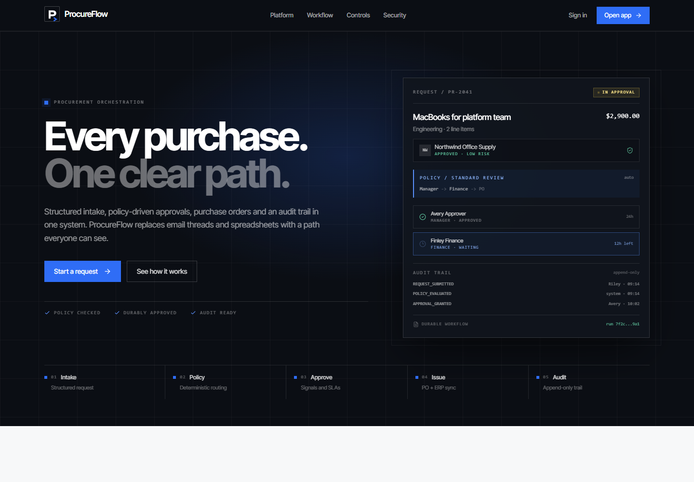
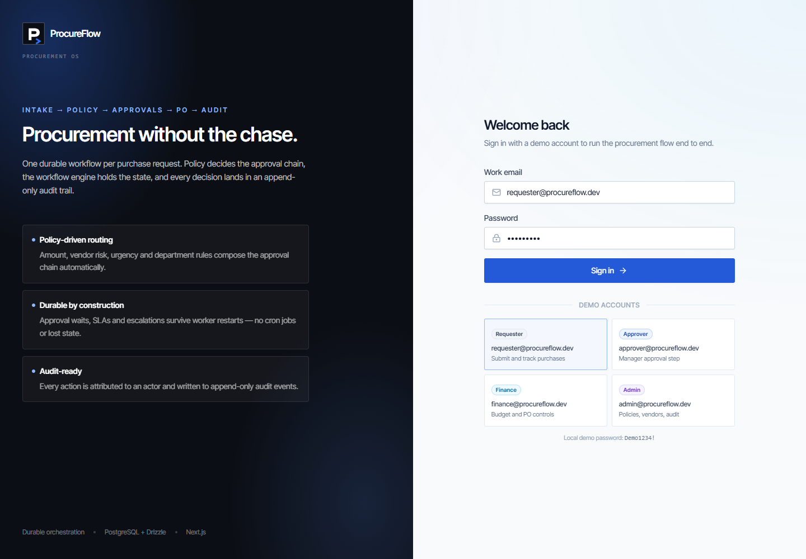
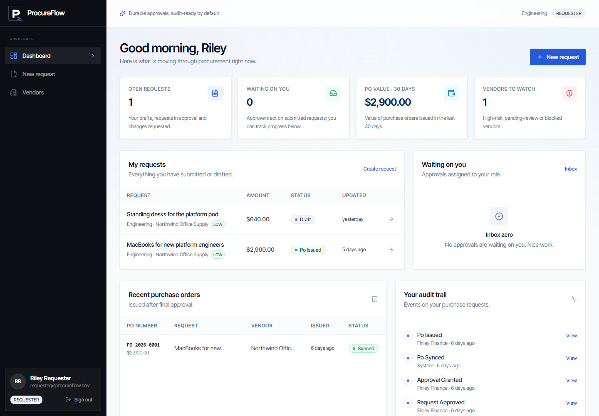
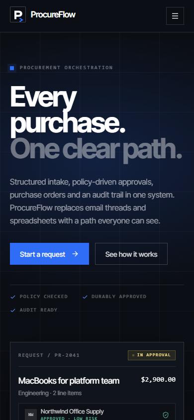
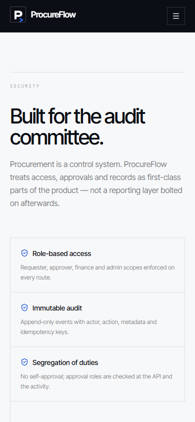
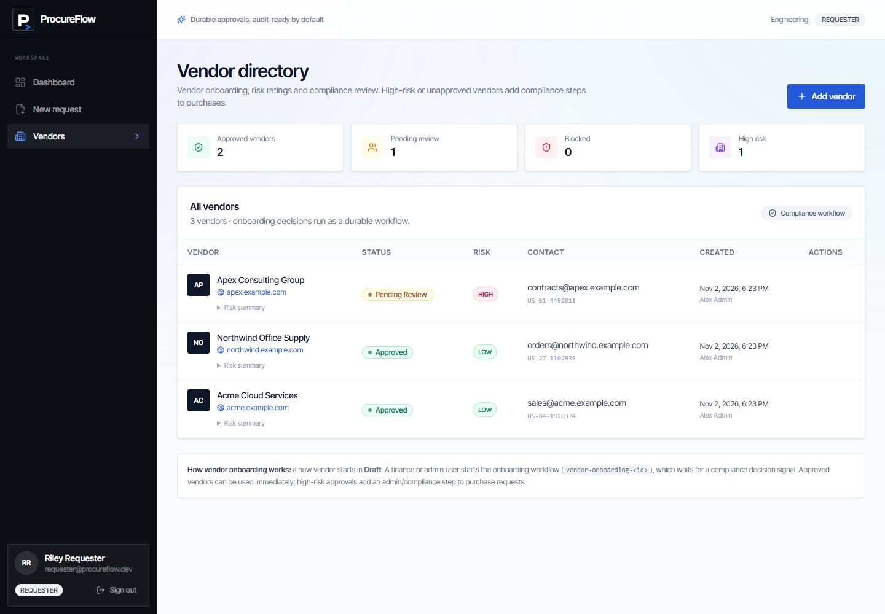
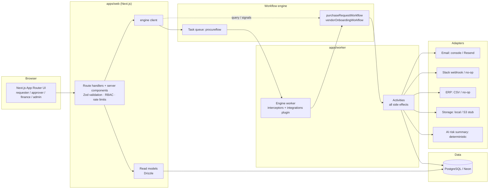
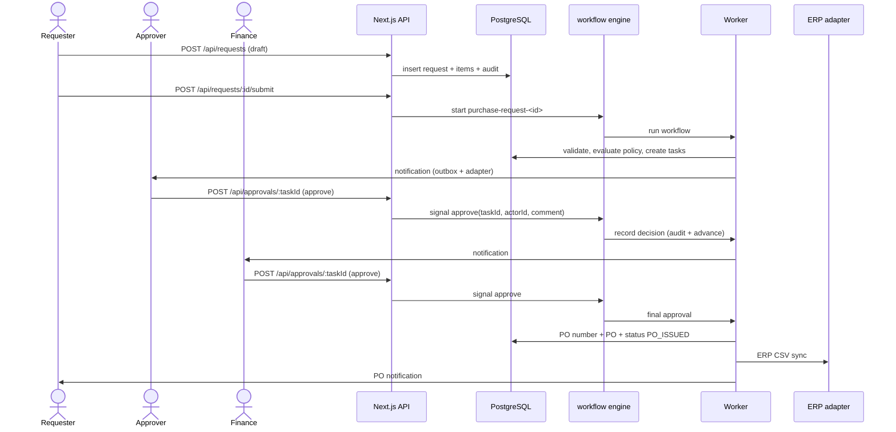

# ProcureFlow

<p align="center">
  <picture>
    <source media="(prefers-color-scheme: dark)" srcset="apps/web/public/brand/logo-light.svg">
    
  </picture>
</p>

**Procurement orchestration with durable workflows.** Intake → policy evaluation →
configurable approvals → purchase order → append-only audit, built as a
production-lean MVP.

ProcureFlow is a focused Zip-style procurement platform: employees submit purchase
requests, a deterministic policy engine decides who must approve, the approval chain
is held durably by the workflow engine, purchase orders are generated after final
approval, and every action is attributed in an audit trail.

- TypeScript end to end (Next.js App Router, durable workflow SDK, Drizzle).
- PostgreSQL locally (Docker/portable) and on Neon in production.
- Durable workflows with signals, queries, timers, SLA escalation and retries.
- Config-only switching between local, stock and managed workflow endpoints.
- Real adapter boundaries for email, Slack, ERP, storage and AI risk summaries.
- Framer Motion for entrance and interaction choreography, with Lucide icons.
- Runnable on Render + Neon with an external workflow engine endpoint.

## What ProcureFlow is for

ProcureFlow is the control layer between a **purchase request** and a **purchase
order**. It is for finance, IT, operations and admin teams that need every purchase
to follow the same policy, reach the right approver and leave an audit trail —
without adopting a full ERP.

**The job it does**

- Gives employees one structured place to request hardware, software, services or supplies.
- Applies a deterministic policy to choose the approval chain, SLA and PO path.
- Holds approvals durably, so decisions survive restarts, deployments and long waits.
- Issues a purchase order with an ERP reference after final approval.
- Records every submission, decision and policy evaluation in an append-only audit trail.

**Who it is for**

- **Requesters** who need a clear status instead of chasing email threads.
- **Managers and finance** who need consistent approvals and spend controls.
- **IT and operations** who buy across many vendors and categories.
- **Admins** who own policies, vendors and the audit record.

**What it is not**

ProcureFlow is not a vendor marketplace, an ERP general ledger, an expense
reimbursement tool or a contract lifecycle suite. It is the focused workflow and
control layer for the procurement decision itself.

## Product tour



| Login | Dashboard |
| --- | --- |
|  |  |

| Mobile landing | Mobile security |
| --- | --- |
|  |  |



---

## Architecture



### Request lifecycle



The API **never mutates approval state directly**: submit starts a workflow and
approval actions only send workflow engine signals. The worker's activities are the only
writers of approval/PO state and audit events.

---

## Repository layout

```text
apps/
  web/                    Next.js App Router UI, API routes, Auth.js
  worker/                 Engine worker process
packages/
  shared/                 Zod schemas, domain types, deterministic policy engine
  db/                     Drizzle schema, migrations, seed, client
  workflows/              Workflows, activities, interceptors, activity contracts
  integrations/           Adapter interfaces + implementations + Worker Plugin
third_party/temporal/     Vendored engine source (upstream + small rework)
scripts/                  Engine build/run, dev orchestration, smoke, CI guard
.github/workflows/ci.yml  Quality, stock-engine E2E, engine compile
docker-compose.yml        Local Postgres
render.yaml               Render web + worker blueprint
VENDOR_BASE.md            Pinned upstream provenance
VENDOR_MODIFICATIONS.md   Every local engine change
```

---

## Quick start (local)

### Prerequisites

| Tool | Version | Notes |
| --- | --- | --- |
| Node.js | 20+ (tested on 24) | Next.js 14, workflow SDK |
| pnpm | 10+ | `corepack enable` |
| Docker | optional if Postgres is already running | `docker compose -f docker-compose.yml -f docker-compose.dev.yml up -d postgres` |
| Go | 1.27+ | Only for the reworked engine build |
| engine CLI | auto-downloaded | Used by `pnpm dev:stock-engine` |

### 1. Environment

```bash
cp .env.example .env
# Edit AUTH_SECRET and INTERNAL_API_TOKEN for anything beyond local demo.
```

### 2. Install and start Postgres

```bash
pnpm install
docker compose -f docker-compose.yml -f docker-compose.dev.yml up -d postgres
```

### 3. Create schema and demo data

```bash
pnpm db:migrate
pnpm db:seed
```

### 4. Run everything

```bash
pnpm dev
```

`pnpm dev` starts, in order:

1. Postgres if it is not already listening on `DATABASE_URL` (via docker compose),
2. the **reworked engine** from `third_party/temporal` (builds it if missing),
3. database migrations + idempotent seed,
4. the workflow engine worker,
5. the Next.js web app at <http://localhost:3000>.

The reworked server persists workflow state in
`third_party/temporal/.build/engine.db` and auto-provisions the `default`
namespace plus ProcureFlow search attributes.

> The reworked engine does not include an inspector UI. The stock engine
> (`pnpm dev:stock-engine`) serves its UI on <http://localhost:8233>;
> `WORKFLOW_ENGINE_UI_URL` is available for operators who expose one separately.

### Stock engine alternative

```bash
pnpm dev:stock-engine
```

This downloads the pinned engine CLI (`v1.9.1`), starts its dev server with the
ProcureFlow search attributes, then runs migrations/seed, worker and web. It is the
flow used by CI and does not require Go.

You can also run pieces separately:

```bash
pnpm engine:dev:stock       # stock engine only
pnpm engine:build           # build reworked engine + bootstrap (Go 1.27+)
pnpm engine:dev             # reworked engine only
pnpm dev                    # full reworked stack
pnpm smoke                  # E2E against a running stack
```

---

## Demo login

All demo users use password **`Demo1234!`** (local/demo only — never use in
production).

| Role | Email | Can do |
| --- | --- | --- |
| Requester | `requester@procureflow.dev` | Create/submit requests, track status, resubmit changes |
| Approver | `approver@procureflow.dev` | Manager approval step |
| Finance | `finance@procureflow.dev` | Finance approvals, vendor review, audit, POs |
| Admin | `admin@procureflow.dev` | Policies, vendor review, audit, escalations |

### Suggested demo path

1. Sign in as **requester** → **New request**.
2. Pick *Northwind Office Supply*, add 2 × $1,450 laptops, justify, submit.
3. The policy engine routes to **Approver → Finance** (total $2,900).
4. Sign in as **approver** → **Approvals** → approve with a comment.
5. Sign in as **finance** → **Approvals** → approve.
6. Open the request: PO is issued and synced, vendor risk summary and full audit
   trail are visible. The workflow engine workflow card shows a live `getState` query.
7. Optional: submit a $12,000 request (adds admin/compliance), or use the pending
   *Apex Consulting Group* high-risk vendor (adds a compliance step).
8. Optional: sign in as **admin** → **Policies** to change amounts/approvers and see
   the next request pick up the new chain. Vendor onboarding is also workflow-driven.

---

## Domain and policy engine

### Entities

`users`, `vendors`, `purchase_requests`, `purchase_request_items`,
`approval_tasks`, `purchase_orders`, `audit_events`, `notification_outbox`,
`policies` (Drizzle schema in `packages/db/src/schema.ts`).

Statuses match the brief: requests move through `DRAFT → SUBMITTED → IN_APPROVAL →
APPROVED → PO_ISSUED`, with `CHANGES_REQUESTED`, `REJECTED`, `CANCELLED` branches.
Approval tasks support `PENDING`, `APPROVED`, `REJECTED`, `CHANGES_REQUESTED`,
`ESCALATED`, `CANCELLED`.

### Policy evaluation

Policies are DB rows (`conditions` + `approvers` JSONB):

- match amount range, departments, categories, vendor risk, vendor status, urgency;
- all populated conditions must match (AND);
- every matching enabled policy contributes approvers;
- approvers de-duplicate by role and are ordered **manager → finance → admin**;
- the longest SLA wins when several rules add the same role;
- an empty approver list means **auto-approve** (request goes straight to PO);
- no match falls back to one admin/compliance review.

Seeded rules: auto-approve ≤ $1,000; manager + finance $1,000.01–$10,000; admin added
above $10,000; high-risk vendor adds admin; vendor not yet approved adds admin;
HIGH urgency gives finance a 12-hour SLA. Amounts are stored as integer cents and
evaluation is pure/deterministic (`packages/shared/src/policy.ts`), unit-tested at
boundaries and for rule merging.

Admins can create/edit/disable policies at `/policies`. Changes apply to new
evaluations; in-flight workflows keep the chain they were created with.

### Vendor onboarding

`vendor-onboarding-<vendorId>` workflow:

1. `beginVendorReview` activity transitions DRAFT → PENDING_REVIEW, audits, notifies
   admins;
2. waits up to 7 days for a `decide` signal from finance/admin;
3. `completeVendorReview` activity sets APPROVED/BLOCKED, updates risk level and a
   deterministic AI risk summary, audits, notifies the creator;
4. if the SLA expires the vendor remains pending and an expiry audit event is written.

---

## Workflow engine implementation

### Workflow IDs

| Workflow | ID |
| --- | --- |
| Purchase request | `purchase-request-<requestId>` (revision 1); `...-r<revision>` only if a previous run closed after the 30-day resubmit window |
| Vendor onboarding | `vendor-onboarding-<vendorId>` |
| Outbox drain | `notification-outbox-<timestamp>-<random>` |

The request stores its `workflowId`, so the API always signals/queries the right run.

### PurchaseRequestWorkflow

- Validates and persists submission via `validateAndSubmitRequest` activity.
- Evaluates policy via `evaluateRequestPolicy` activity (reads policies from DB).
- Creates approval tasks with due dates via `createApprovalPlan`.
- Sends outbox-backed email/Slack notifications via activities.
- Waits on signals `approve`, `reject`, `requestChanges` (payload: taskId, actorId,
  comment), plus `resubmit` for the changes-requested loop.
- Uses `workflow.condition` with per-step timers:
  - on SLA expiry, escalates the task to ADMIN with a new 24h deadline;
  - if the admin SLA also expires, rejects the request with an audit reason.
- Final approval → PO number + PurchaseOrder + `PO_ISSUED`; notifies requester and
  finance; syncs the PO to the ERP adapter (CSV locally) with heartbeats.
- Rejection closes the request and notifies the requester.
- Changes requested transitions to `CHANGES_REQUESTED`, notifies the requester and
  waits for a `resubmit` signal (30 days). Resubmission increments the revision,
  re-evaluates policy and reuses the same workflow ID.
- Exposes query `getState` returning DB status, approval chain, pending task,
  policy explanation, last decision and an in-workflow audit summary.
- All activities have retry policies; validation/authorization failures are
  non-retryable `ApplicationFailure`s. Side-effecting writes use unique dedupe keys
  (`workflowId + step + action`), so activity retries do not duplicate audit events,
  tasks, POs or notifications.
- The workflow never performs DB/network I/O.

### Idempotency

- `audit_events.dedupe_key` unique (nullable for user-driven CRUD).
- `notification_outbox.dedupe_key` unique; failed rows are retried, sent rows are
  skipped.
- `approval_tasks (request_id, step_order)` unique and upserted on each plan.
- `purchase_orders.request_id` unique; PO number collisions retry.
- Request workflow ID is deterministic; duplicate starts are treated as already
  running and signal-based resubmission resumes the original run.

### Interceptor and Worker Plugin (extension points)

- `packages/workflows/src/interceptors.ts` — workflow inbound/outbound interceptor
  that attaches actorId/actorRole/requestId to workflow logs and records every
  signal. Registered via Worker `interceptors.workflowModules`.
- `packages/workflows/src/activity-interceptors.ts` — activity inbound/outbound
  interceptor using AsyncLocalStorage so structured activity logs include actor and
  request context. Registered via Worker `interceptors.activity`.
- Both are optional: `PROCUREFLOW_AUDIT_INTERCEPTOR_ENABLED=false` skips them.
- `packages/integrations/src/worker-plugin.ts` — `IntegrationsWorkerPlugin`
  instantiates the configured adapters before the Worker starts and exposes them
  through a registry that activities resolve at execution time. Swap providers with
  env config (or implement the interface); workflows never change.
  Disable with `PROCUREFLOW_WORKER_PLUGIN_ENABLED=false`.

---

## Engine rework (local runtime)

The engine **server** source is vendored at `third_party/temporal/` (upstream
`main` @ `96a50b1`, 2026-11-02). Exact provenance and the local tag are in
[`VENDOR_BASE.md`](./VENDOR_BASE.md); every local change is in
[`VENDOR_MODIFICATIONS.md`](./VENDOR_MODIFICATIONS.md).

The upstream server code is **unmodified**. The rework consists of:

1. `cmd/tools/procureflow-bootstrap/main.go` — uses the public Go SDK operator API
   to wait for the server, create the namespace and idempotently register the three
   `ProcureFlow*` Keyword search attributes.
2. `config/procureflow-dev.yaml` — durable SQLite dev topology (`.build/engine.db`)
   so approval workflows survive worker/server restarts.

Why not patch server internals? The required behavior is achievable with SDK APIs,
interceptors, a Worker Plugin and operator APIs; keeping server code pristine means
the same app works on managed and stock engines. See the rationale and the
preferred-extension-point checklist in `VENDOR_MODIFICATIONS.md`.

Build and run:

```bash
pnpm engine:build   # requires Go 1.27+
pnpm engine:dev     # SQLite durable server + bootstrap
```

Search attribute behavior is gated by `WORKFLOW_ENGINE_SEARCH_ATTRIBUTES`:

- `true` → workflows upsert `ProcureFlowDepartment`, `ProcureFlowRisk`,
  `ProcureFlowStatus`; the reworked bootstrap ensures they exist. Verified via
  the engine inspector and a visibility query.
- `false` (default for the stock engine or a managed service) → the app skips those upserts and uses the
  PostgreSQL read model for everything. No code changes.

CI runs all functional tests against **stock engine CLI**, plus a compile-only job
for the reworked server, so the rework is never load-bearing for basic functionality.

### Managed deployment split

| Environment | Engine | Notes |
| --- | --- | --- |
| Local dev | Reworked engine (`pnpm dev`) | Durable SQLite, bootstrap, custom search attributes |
| Local fallback / CI | Stock engine (`pnpm dev:stock-engine`) | No Go required; proves portability |
| Self-hosted | Any stock engine cluster | Point `WORKFLOW_ENGINE_ADDRESS`; keep rework flag false |
| Render + Neon | managed service or external engine | Reworked server is **not** deployed to Render |

---

## API

All inputs are validated with Zod; RBAC is enforced server-side; cookie-authenticated
mutations reject cross-origin requests; login/approval/public mutations are rate
limited per process.

| Method | Route | Purpose |
| --- | --- | --- |
| `*` | `/api/auth/[...nextauth]` | Auth.js credentials login/session |
| `GET` | `/api/health` | DB + workflow engine readiness (200/503) |
| `GET/POST` | `/api/requests` | List my/all requests; create draft |
| `GET/PATCH` | `/api/requests/:id` | Detail + live workflow state; edit draft/changes |
| `POST` | `/api/requests/:id/submit` | Start/resume `purchaseRequestWorkflow` |
| `POST` | `/api/requests/:id/cancel` | Cancel a draft |
| `GET` | `/api/approvals` | Active approval inbox for the actor’s role |
| `POST` | `/api/approvals/:taskId` | Signal approve / reject / request changes |
| `GET/POST` | `/api/vendors` | Vendor directory / create DRAFT vendor |
| `GET/PATCH` | `/api/vendors/:id` | Vendor detail / edit |
| `POST` | `/api/vendors/:id/review` | Start vendor onboarding workflow |
| `POST` | `/api/vendors/:id/decision` | Signal compliance decision |
| `GET/POST` | `/api/policies` | List/create policies (admin) |
| `PATCH` | `/api/policies/:id` | Edit policy (admin) |
| `GET` | `/api/audit` | Filter/paginate audit log (admin/finance) |
| `POST` | `/api/assistant/conversations` | Start a requester-scoped assistant intake |
| `POST` | `/api/assistant/conversations/:id/turns` | Send one conversation turn |
| `GET` | `/api/assistant/reviews` | Role-scoped assistant review queue |
| `POST` | `/api/assistant/reviews/:id` | Approve/reject/edit an escalation |
| `POST` | `/api/internal/outbox` | Retry outbox notifications (Bearer `INTERNAL_API_TOKEN` or admin) |

Pages: `/` marketing landing, `/login`, `/dashboard`, `/requests/new` wizard,
`/requests/:id` timeline, `/approvals` inbox, `/vendors` directory, `/policies`
admin, `/audit` log, `/assistant` guided intake, `/assistant/reviews` HITL queue.

### Procurement assistant

The assistant is a separate deterministic Python orchestrator with a local model as its
language interface. The model does not choose the next slot, readiness, routing,
submission, retries, or permissions. See
[services/assistant/README.md](services/assistant/README.md).

Run it locally:

```bash
ollama serve
ollama pull phi4-mini:3.8b
pnpm db:migrate
pnpm assistant:dev
# in another terminal
pnpm dev
```

The assistant service is also part of `docker-compose.yml`; Ollama stays on the host and
is reached at `host.docker.internal:11434`. No conversation or model data leaves the
machine. The default confidence thresholds are conservative calibration seeds:

```env
ASSISTANT_MODEL="phi4-mini:3.8b"
ASSISTANT_MODEL_QUANTIZATION="Q4_K_M"
ASSISTANT_AUTO_ACCEPT_LIMIT_CENTS="250000"
ASSISTANT_HIGH_MIN_LOGPROB="-0.35"
ASSISTANT_MID_MIN_LOGPROB="-1.0"
```

Every turn exposes only the tools allowed at that step; filled and dependency-blocked
slots are never sent to the model. Low confidence, malformed tool calls, failed
guardrails, and consequential routing go to a role-scoped review queue. The assistant
can create a **draft** only — it never submits or approves.

---

## Integrations

Interfaces live in `packages/integrations/src/types.ts`; local implementations work
with no configuration:

| Adapter | Local | Production path |
| --- | --- | --- |
| Email | Console structured log | `EMAIL_ADAPTER=resend` + `RESEND_API_KEY` (implemented) |
| Slack | No-op unless `SLACK_WEBHOOK_URL` is set | Incoming webhook (implemented) |
| ERP | CSV per PO in `ERP_CSV_DIR` | Implement `ErpAdapter` for NetSuite/SAP/Ariba |
| Storage | Local filesystem | `S3StorageAdapter` stub (metadata-only attachments in MVP) |
| AI risk | Deterministic, offline summary | Replace `AiRiskSummaryAdapter` with an LLM agent |

All outbound notifications are also written to `notification_outbox` with status and
error, so failures are visible and retryable. `POST /api/internal/outbox` starts the
`notificationOutboxWorkflow`, which runs the drain activity through the same adapters.

---

## Testing

```bash
pnpm test:unit       # policy engine + Zod schemas
pnpm test:workflows  # workflow engine workflow integration tests (5 scenarios)
pnpm assistant:test  # 16 deterministic assistant replay tests
pnpm typecheck
pnpm lint
pnpm build
pnpm engine:check  # workflow engine modification log freshness
pnpm smoke           # full HTTP + workflow engine + DB E2E against a running stack
```

Workflow tests use the durable workflow test harness and cover: manager+finance approval → PO,
rejection, changes requested + resubmission, SLA escalation to admin, and
auto-approval. They download/cache a workflow engine test server on first run.

CI (`.github/workflows/ci.yml`):

1. **quality** — install, workflow engine diff guard, lint, typecheck, unit tests, production
   build.
2. **stock-engine** — Postgres service, stock engine CLI dev server, workflow
   tests, worker + web, full smoke test.
3. **engine-build** — compiles the reworked server and bootstrap with Go.

---

## Docker / Coolify deployment

The default `docker-compose.yml` is a deployable application stack, not a
database-only file. It contains four services:

| Service | Type | Purpose |
| --- | --- | --- |
| `web` | Application (built from `Dockerfile`) | Next.js UI + API; assign the public domain and port 3000 |
| `worker` | Application (built from `Dockerfile`) | Durable workflow worker; no public domain |
| `engine` | Internal service | Workflow engine (stock auto-setup image) on `engine:7233` |
| `postgres` | Database | PostgreSQL 16 with a persistent volume |

This is why the old Coolify error appeared: the previous compose file exposed only
the Postgres service, so Coolify had no non-database service to attach a domain to.

### Coolify steps

1. Create a **Docker Compose** resource from this repository.
2. Use `/docker-compose.yml` as the compose file and branch `main`.
3. Set these environment variables in Coolify:
   - `APP_URL` — the final public URL, e.g. `https://procureflow.example.com`
   - `POSTGRES_PASSWORD` — recommended; use a long URL-safe password
   - `AUTH_SECRET` — optional but recommended for explicit control
   - `INTERNAL_API_TOKEN` — optional but recommended for explicit control
   - `SEED_DEMO_DATA` — `true` on the **first** deployment if you want the demo users
     (`requester@procureflow.dev` / `Demo1234!`), then `false` and change the users.
     It is `false` by default for a real deployment.
4. Deploy. The web container runs `pnpm db:migrate` before `next start`.
5. Assign the domain to the **`web`** service and set the internal port to **3000**.
   In Coolify's domain field, use `https://your-domain:3000`, or set **Port** to
   `3000` explicitly. The `:3000` is the internal container port; normal visitors
   still use HTTPS on port 443. Do not assign domains to `postgres`, `engine`, or `worker`.
   Do **not** use `127.0.0.1` as the domain; that points the browser at its own
   machine and cannot receive a TLS certificate.
6. Set `APP_URL` to the assigned public domain **without** `:3000`
   (for example `https://procureflow.example.com`) and redeploy if it was not
   known up front.

The `web` service publishes container port `3000` for Coolify's proxy/health
checks as well as direct testing. A temporary `http://SERVER_PUBLIC_IP:3000`
check will show “not secure” because it bypasses HTTPS; use a real DNS name for
TLS. A `502 Bad Gateway` means the proxy cannot reach the web container — verify
the domain is pointing at the Coolify server and the `web` service is healthy.

### DNS, TP-Link router pages, and 127.0.0.1

If the browser opens a TP-Link admin page instead of ProcureFlow, the hostname is
resolving to the router, not to the Coolify server. `127.0.0.1` is never a valid
public deployment domain.

1. On the Coolify server, find its public IPv4 address:

   ```bash
   curl -4 https://ifconfig.me
   ```

2. At your DNS provider, create an **A record** for the app hostname pointing to
   that public IP. Do not include `https://`, a port, `127.0.0.1`, or a private
   `192.168.x.x` address in the DNS record.

3. If the server is behind a TP-Link router, forward inbound TCP **80** and
   **443** to the server's LAN IP. Do not forward them to the router's own admin
   interface. A router page on the app hostname usually means the A record points
   at the router or the request is hitting router management.

4. Verify from an external network / phone hotspot:

   ```bash
   nslookup app.example.com 8.8.8.8
   ```

   It must return the public IP from step 1. If it returns `127.0.0.1`,
   `192.168.x.x`, or the router address, fix the A record and wait for TTL.

5. In Coolify use `https://app.example.com:3000` (or set Port `3000`), and set
   `APP_URL=https://app.example.com`. Redeploy after the DNS record is correct.

Hairpin NAT can make the domain fail from inside the same LAN even when it works
externally; test from a phone on cellular data before changing the app.

`AUTH_SECRET` and `INTERNAL_API_TOKEN` are not required during `docker compose build`.
If omitted at runtime, the web entrypoint generates strong values on first boot and
persists them in the `procureflow_runtime` volume, so sessions survive restarts.
Set them explicitly if you run multiple web replicas. The Coolify health check only
verifies that the web server is serving `/login`; full DB and engine readiness is
reported separately at `/api/health`.

Local production-mode test:

```bash
docker compose -f docker-compose.yml -f docker-compose.dev.yml up -d --build
docker compose -f docker-compose.yml -f docker-compose.dev.yml ps
# open http://localhost:3000
```

For local Postgres-only development, keep using the dev override:

```bash
docker compose -f docker-compose.yml -f docker-compose.dev.yml up -d postgres
```

`coolify.env.example` lists the required values. Never commit a filled-in copy.
The Postgres, engine, and runtime data volumes persist across container restarts.

---

## Render + Neon deployment

### Neon

1. Create a Neon project and database.
2. Copy the **pooled** connection string into `DATABASE_URL` (add
   `?sslmode=require` if Neon does not include it).
3. Copy the **direct** connection string into `DIRECT_URL` (used by migrations).
4. Set `DATABASE_SSL=true`, `DATABASE_POOLED=true`. The app uses postgres.js with
   `prepare: false` for pooled endpoints, `DATABASE_URL` at runtime and `DIRECT_URL`
   for `pnpm db:migrate` and the seed.

### Render

1. Push the repo to GitHub.
2. Render → **New → Blueprint** → select the repo (`render.yaml`).
3. Fill the `sync: false` env vars: Neon URLs, `WORKFLOW_ENGINE_ADDRESS`,
   `WORKFLOW_ENGINE_NAMESPACE`, `WORKFLOW_ENGINE_API_KEY` (managed engine), `WORKFLOW_ENGINE_UI_URL`,
   `AUTH_URL` (your Render web URL), optional Resend/Slack keys.
4. Deploy. The web service runs `pnpm db:migrate` as a pre-deploy command and
   exposes `/api/health`; the worker runs
   `pnpm --filter @procureflow/worker start`.
5. Deploy the web service before/with the worker so migrations run first. If you
   prefer a separate migration step, run `pnpm db:migrate` from a Render shell or CI
   with `DIRECT_URL`.

`RENDER_EXTERNAL_URL` is used automatically for Auth.js when `AUTH_URL` is unset.

**managed engine:** create a namespace, copy the gRPC endpoint into
`WORKFLOW_ENGINE_ADDRESS`, set `WORKFLOW_ENGINE_NAMESPACE`, `WORKFLOW_ENGINE_TLS=true`,
`WORKFLOW_ENGINE_API_KEY`, and keep `WORKFLOW_ENGINE_SEARCH_ATTRIBUTES=false`. The app uses official
SDK packages only and requires no code changes.

**Do not attempt to run the reworked engine server on Render in this MVP.** It is
a local/self-hosted development artifact; use managed engine or an external
self-hosted endpoint for managed deployment.

---

## Environment variables

See [`.env.example`](./.env.example) for the complete annotated list. Core values:

| Variable | Purpose |
| --- | --- |
| `DATABASE_URL` | Runtime Postgres URL (Neon pooled) |
| `DIRECT_URL` | Migration/seed Postgres URL (Neon direct) |
| `DATABASE_SSL`, `DATABASE_POOLED` | SSL and PgBouncer-compatible prepared statements |
| `AUTH_SECRET` | Auth.js signing secret (32+ random bytes) |
| `AUTH_URL` / `NEXTAUTH_URL` | Public app URL for callbacks and email links |
| `WORKFLOW_ENGINE_ADDRESS` | gRPC endpoint (local, stock, managed) |
| `WORKFLOW_ENGINE_NAMESPACE` | Namespace |
| `WORKFLOW_ENGINE_TASK_QUEUE` | Default `procureflow` |
| `WORKFLOW_ENGINE_TLS`, `WORKFLOW_ENGINE_API_KEY` | managed service / mTLS endpoints |
| `WORKFLOW_ENGINE_SEARCH_ATTRIBUTES` | Enable ProcureFlow search attributes (rework only) |
| `WORKFLOW_ENGINE_UI_URL` | Optional engine inspector URL for operators |
| `PROCUREFLOW_AUDIT_INTERCEPTOR_ENABLED` | Enable custom interceptors |
| `PROCUREFLOW_WORKER_PLUGIN_ENABLED` | Enable adapter Worker Plugin |
| `EMAIL_*`, `SLACK_WEBHOOK_URL`, `ERP_*`, `STORAGE_*`, `AI_RISK_SUMMARY_ENABLED` | Integration configuration |
| `INTERNAL_API_TOKEN` | Bearer token for `/api/internal/outbox` |

Never commit `.env` or real secrets. `.env.example` contains local-only placeholders.

---

## Assumptions and MVP limits

- **Single-tenant, role-based approvals.** Any active user with the task’s role can
  act; admins can act on any active step. Requesters cannot approve their own
  requests. There is no per-department manager mapping in the MVP; policies route by
  role.
- **Amounts are integer cents** in the database; the UI accepts dollars and converts
  without float drift. Currency is display-only (no FX conversion).
- **Policy precedence:** matching rules merge, roles are de-duplicated and ordered
  manager → finance → admin. “No approvers” on a matching rule means auto-approve.
- **Vendor status matters:** a request may target a DRAFT/PENDING vendor (it adds a
  compliance step), but a BLOCKED vendor is rejected at submission.
- **Approval SLAs:** one escalation to ADMIN with a fresh 24h deadline; a second
  expiry rejects the request. Timers are workflow engine timers.
- **Changes requested:** the workflow waits 30 days for a resubmission signal. If it
  completes, a later resubmission starts a revision-suffixed deterministic workflow.
- **Notifications are best-effort at the workflow boundary:** failures are recorded
  in the outbox and retried by activities; a notification failure does not roll back
  a PO. The outbox endpoint/workflow can retry failed rows.
- **Attachments are metadata-only** in the MVP; storage adapter is ready for S3.
- **Rate limiting is per-process** (in-memory). Use Redis/Upstash for multi-instance
  production clusters.
- **Auth.js v4 credentials + JWT sessions** are used for simplicity; session
  revocation is by JWT expiry (8h) rather than server-side session tables.
- **Search attributes are optional** and only used when the reworked engine flag is
  on. The PostgreSQL read model is the source of truth for lists/dashboards.
- **CSV ERP sync** writes one file per PO; a failed sync marks the PO FAILED and
  leaves it issued, retryable by finance/ops.

---

## Troubleshooting

**`Error: connect ECONNREFUSED 127.0.0.1:5432`** — start Postgres
(`docker compose -f docker-compose.yml -f docker-compose.dev.yml up -d postgres`)
or fix `DATABASE_URL`.

**`Cannot find module '@procureflow/...'`** — run `pnpm install` at the repo root
(workspace packages are linked through pnpm).

**Reworked engine build fails** — install Go 1.27+ (`go version`) or let
`GOTOOLCHAIN=auto` download it. `pnpm engine:build` prints the exact command.
Windows users can use the Node-based build/run scripts (`pnpm engine:build`,
`pnpm engine:dev`) or WSL/Git Bash for the `.sh` equivalents.

**Port 7233 already in use** — another workflow engine dev server is running. Stop it, or
change `WORKFLOW_ENGINE_ADDRESS`/the dev ports consistently. The reworked config uses
7233/7243 and the stock CLI uses 7233/8233.

**Search attribute upsert fails (`invalid search attribute`)** — you are running a
stock server with `WORKFLOW_ENGINE_SEARCH_ATTRIBUTES=true` but without the ProcureFlow
attributes. Set the flag to `false`, or run `pnpm engine:dev` (bootstrap creates
them), or register them through the engine operator tooling.

**Workflow query returns null / “state unavailable”** — the worker or workflow engine is not
reachable; the DB read model still renders. Check `/api/health` and the worker log.

**Login works but pages redirect to `/login`** — `AUTH_SECRET` changed between
processes, or the browser clock/cookie domain differs. Restart web/worker with the
same `.env`.

**A different app answers on `localhost:3000`** — a stale local/WSL Next server can
hold loopback port 3000 while Docker publishes on another interface. The page may
look like ProcureFlow but use a different database, so login fails and the Docker
logs show no auth request.

Check the listener and WSL:

```bash
netstat -ano | findstr :3000
wsl --list --running
```

Stop the old dev server, or run the Docker stack on another host port:

```bash
WEB_PORT=3001 docker compose -f docker-compose.yml -f docker-compose.dev.yml up -d --force-recreate web
```

Then open **http://localhost:3001**. The dev override automatically points
`APP_URL`, `AUTH_URL`, and `NEXTAUTH_URL` at `WEB_PORT`.

**Demo accounts cannot sign in** — the login page exists, but the seed has not run
or the browser is using a different hostname than `AUTH_URL`. Demo users are created
only by `pnpm db:seed`.

For Docker:

```bash
docker compose exec web pnpm db:seed
docker compose exec postgres psql -U procureflow -d procureflow \
  -c 'select email, role, active from users;'
```

For the local dev override, `SEED_DEMO_DATA` is already enabled:

```bash
docker compose -f docker-compose.yml -f docker-compose.dev.yml up -d --force-recreate web
```

Use **http://localhost:3000** consistently. If `APP_URL` is a public HTTPS domain,
Auth.js may issue secure cookies that the browser will not send to `localhost`.
Set `APP_URL=http://localhost:3000`, `AUTH_URL=http://localhost:3000`, and
`NEXTAUTH_URL=http://localhost:3000` for local testing.

**Stock engine workflow tests download slowly the first time** — the test harness
caches the test server under the OS temp directory. Subsequent runs are fast.

---

## GitHub

Published at <https://github.com/olenny-coder/procureflow> (public).

```bash
git remote -v
git push origin main
git push --tags   # publish vendor-base-96a50b1 for the CI provenance guard
```

Add repository secrets for Render, Neon and your engine endpoint; never commit them.
CI runs on push and pull requests.

## License

MIT — see [`LICENSE`](./LICENSE). The vendored workflow engine tree retains its MIT license
at `third_party/temporal/LICENSE`.
